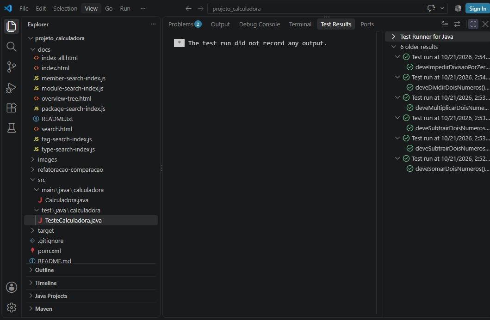
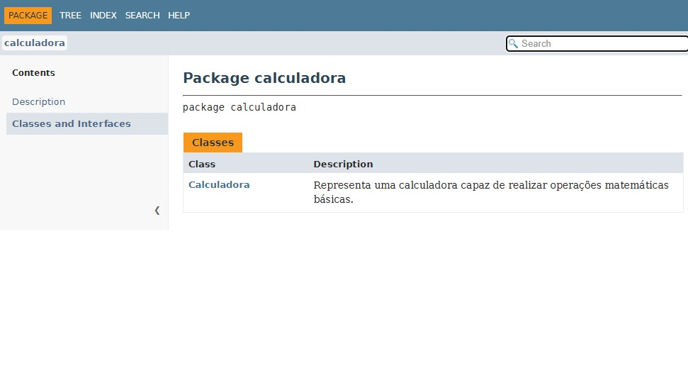

# Projeto Calculadora — FinançApp

>  Este projeto foi desenvolvido como atividade acadêmica para praticar a criação de uma calculadora em Java e aplicar conceitos de testes, tratamento de erros, refatoração, documentação e versionamento com Git e GitHub.
---

## 1. Identificação do Projeto

**Projeto:** Projeto Calculadora  
**Contexto:** FinançApp  
**Aluno:** André Machado  
**RA:** 250803
**Curso:** Análise e Desenvolvimento de Sistemas  
**Instituição:** Centro Universitário Facens  
**Disciplina:** UX/UI
**Professor:** Daniel Ohata
**Semestre:** 2026.2  

---

## 2. Visão Geral

O projeto consiste no desenvolvimento de um módulo de cálculos matemáticos básicos em Java para a startup fictícia **FinançApp**.

O módulo foi desenvolvido para ser utilizado futuramente em funcionalidades de controle financeiro, como orçamento mensal, divisão de despesas, projeções financeiras e cálculos auxiliares.

Além do funcionamento correto das operações, o projeto aplica práticas de qualidade de software relacionadas a testes, tratamento de erros, refatoração, documentação e versionamento.

---

## 3. Problema

Durante o desenvolvimento da aplicação FinançApp, foi identificada a necessidade de criar um módulo matemático reutilizável.

O módulo deve funcionar corretamente e apresentar código legível, testes automatizados, tratamento de falhas, documentação técnica, controle de versões e facilidade de manutenção.

---

## 4. Objetivo

### 4.1 Objetivo Geral

Desenvolver uma calculadora em Java aplicando práticas de qualidade, testes, documentação, refatoração e versionamento.

### 4.2 Objetivos Técnicos

- Implementar operações matemáticas básicas.
- Tratar entradas inválidas.
- Impedir divisão por zero.
- Desenvolver testes automatizados.
- Refatorar o código sem alterar seu comportamento.
- Documentar classes e métodos com JavaDoc.
- Gerar documentação HTML.
- Utilizar Git e GitHub.
- Organizar commits e branches.

---

## 5. Escopo Funcional

| ID | Funcionalidade | Descrição | Status |
|---|---|---|---|
| RF01 | Soma | Soma dois números inteiros | ✅ |
| RF02 | Subtração | Subtrai dois números inteiros | ✅ |
| RF03 | Multiplicação | Multiplica dois números inteiros | ✅ |
| RF04 | Divisão | Divide dois números inteiros | ✅ |
| RF05 | Validação de divisão | Impede divisão por zero | ✅ |
| RF06 | Operação inválida | Trata operadores não suportados | ✅ |

---

## 6. Requisitos Não Funcionais

| ID | Categoria | Requisito |
|---|---|---|
| RNF01 | Qualidade | Código organizado e legível |
| RNF02 | Testabilidade | Operações cobertas por testes automatizados |
| RNF03 | Manutenção | Código preparado para refatoração |
| RNF04 | Documentação | Classes e métodos documentados com JavaDoc |
| RNF05 | Versionamento | Utilização de Git e GitHub |
| RNF06 | Confiabilidade | Tratamento de situações de erro |

---

## 7. Tecnologias Utilizadas

| Tecnologia | Utilização |
|---|---|
| Java 17 | Desenvolvimento |
| JUnit 5 | Testes unitários |
| Maven | Gerenciamento e execução do projeto |
| Git | Controle de versão |
| GitHub | Repositório remoto |
| JavaDoc | Documentação técnica |
| IDE | Desenvolvimento |

---

## 8. Estrutura do Projeto

```text
projeto_calculadora/
│
├── src/
│   ├── main/
│   │   └── java/
│   │       └── calculadora/
│   │           └── Calculadora.java
│   │
│   └── test/
│       └── java/
│           └── calculadora/
│               └── TesteCalculadora.java
│
├── docs/
│   └── index.html
│
├── images/
│   ├── testes/
│   ├── javadoc/
│   └── refatoracao/
│
├── pom.xml
├── README.md
└── .gitignore
```

---

## 9. Operações Implementadas

### Soma

Utiliza o operador `+`.

Exemplo:

```text
10 + 5 = 15
```

### Subtração

Utiliza o operador `-`.

Exemplo:

```text
10 - 5 = 5
```

### Multiplicação

Utiliza o operador `*`.

Exemplo:

```text
10 * 5 = 50
```

### Divisão

Utiliza o operador `/`.

Exemplo:

```text
10 / 5 = 2
```

### Divisão por zero

A divisão por zero é tratada por meio de `ArithmeticException`, impedindo que a operação seja executada de maneira incorreta.

### Operação inválida

Operadores diferentes de `+`, `-`, `*` e `/` são rejeitados por meio de `IllegalArgumentException`.

---

## 10. Testes Unitários



Foram implementados testes utilizando **JUnit 5** para validar:

- soma;
- subtração;
- multiplicação;
- divisão;
- divisão por zero;
- operação inválida.

### Resultado esperado

Todos os testes devem ser aprovados após a execução:

```text
Tests run: 6
Failures: 0
Errors: 0
Skipped: 0
```

> Substitua ou complemente esta seção com o print real da execução dos testes.

### Print dos testes

Coloque a captura de tela em:

```text
images/testes/
```

Exemplo:

```markdown

```

---

## 11. Refatoração


Foi criada uma branch específica para a refatoração:

```text
Refatoracao
```

Durante a refatoração foram aplicadas técnicas como:

- extração de métodos;
- melhoria dos nomes;
- simplificação das estruturas condicionais;
- organização lógica;
- melhoria da legibilidade;
- separação das responsabilidades.

O comportamento funcional da calculadora foi preservado.

Após a refatoração, os testes unitários devem ser executados novamente para confirmar que não houve regressão.

---

## 12. Documentação JavaDoc


A classe `Calculadora` e seus métodos possuem documentação técnica utilizando JavaDoc.

A documentação inclui:

- descrição das classes;
- descrição dos métodos;
- parâmetros;
- retornos;
- exceções;
- autor;
- versão.

A documentação HTML deve ser gerada na pasta:

```text
docs/
```

O arquivo principal é:

```text
docs/index.html
```

### Print da documentação

Coloque a captura de tela em:

```text
images/javadoc/
```

Exemplo:

```markdown

```

---

## 13. Versionamento

O projeto utiliza Git para controle de versão.

Branches principais:

```text
main
Refatoracao
```

Sugestão de organização dos commits:

```text
feat: cria estrutura inicial do projeto
feat: implementa classe Calculadora
test: adiciona testes unitários
docs: adiciona JavaDoc
refactor: reorganiza código da calculadora
docs: adiciona documentação HTML
docs: atualiza README
```

---

## 14. GitHub

**Repositório:** [COLOCAR LINK DO REPOSITÓRIO]

O repositório remoto deverá conter:

- código-fonte;
- testes;
- documentação;
- README;
- branch `main`;
- branch `Refatoracao`;
- histórico de commits organizado.

---

## 15. Conclusão

O projeto permitiu aplicar conceitos fundamentais de qualidade de software em uma aplicação Java simples.

Foram trabalhados desenvolvimento funcional, testes unitários, tratamento de erros, refatoração, documentação técnica e versionamento.

A utilização dessas práticas contribui para um código mais confiável, legível, organizado e preparado para manutenção e evolução futura.

---

## 16. Autor

**André Machado**  
Centro Universitário Facens  
Curso de Análise e Desenvolvimento de Sistemas
