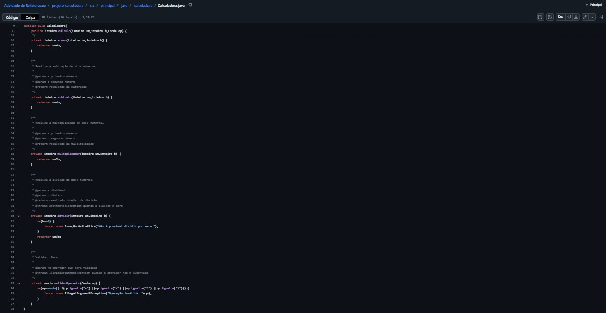

# Projeto Calculadora — FinançApp

> Este projeto foi desenvolvido como atividade acadêmica para praticar a criação de uma calculadora em Java. Durante o desenvolvimento, trabalhei com operações matemáticas, testes unitários, tratamento de erros, refatoração, documentação e versionamento do projeto.

---

## 1. Identificação do Projeto

*Projeto:* Projeto Calculadora
*Contexto:* FinançApp
*ALuno:* André Machado
*RA:* 250803
*Curso:* Análise e Desenvolvimento de Sistemas
*Instituição:* Centro Universitário Facens
*Disciplina:* UX/UI
*Professor:* Daniel Ohata
*Semestre:* 2026.2

---

## 2. Visão Geral

O projeto consiste em uma calculadora desenvolvida em Java para realizar operações matemáticas básicas. A proposta é que esse módulo possa ser utilizado futuramente em funcionalidades da startup fictícia *FinançApp*, como cálculos de despesas e organização financeira.

Além de implementar as operações, o projeto busca manter o código organizado, facilitar a identificação de erros e permitir que futuras alterações sejam realizadas com mais facilidade.

---

## 3. Problema

Uma aplicação voltada para o controle financeiro precisa realizar cálculos corretamente e tratar situações inesperadas. Por isso, a calculadora precisa lidar com operações inválidas e evitar problemas como a divisão por zero.

Também é importante que o código seja organizado e fácil de entender, facilitando sua manutenção e possíveis melhorias.

---

## 4. Objetivo

### 4.1 Objetivo geral

Desenvolver uma calculadora em Java e aplicar conhecimentos relacionados à qualidade, aos testes, à documentação, à refatoração e ao versionamento de software.

### 4.2 Objetivos específicos

- Implementar as quatro operações matemáticas básicas.
- Tratar divisão por zero e operadores inválidos.
- Criar testes unitários para verificar os resultados.
- Refatorar o código para melhorar sua organização.
- Documentar classes e métodos com JavaDoc.
- Gerar a documentação em formato HTML.
- Utilizar Git para acompanhar as alterações do projeto.
- Utilizar o GitHub para armazenar e organizar os arquivos.

---

## 5. Funcionalidades Implementadas

| Código| Funcionalidade| Descrição
|---|---|---|---|
RF01| Soma| Soma dois números inteiros.
RF02| Subtração| Subtrai dois números inteiros.
RF03| Multiplicação| Multiplica dois números inteiros.
RF04| Divisão| Divide dois números inteiros.
RF05| Divisão por zero| Trata a tentativa de divisão por zero.
RF06| Operação inválida| Trata operadores não suportados.

---

## 6. Requisitos de Qualidade

Durante o desenvolvimento, foram considerados alguns aspectos importantes:

- Organização: manter o código legível e bem estruturado.
- Testabilidade: verificar as operações por meio de testes automatizados.
- Manutenção: facilitar futuras alterações no código.
- Documentação: explicar o funcionamento das classes e dos métodos.
- Confiabilidade: tratar situações que podem gerar erros.
- Versionamento: acompanhar as mudanças realizadas no projeto.

  ---

## 7. Tecnologias Utilizadas

Tecnologia| Utilização
|---|---|
Java 24| Desenvolvimento da calculadora.
JUnit 5| Criação e execução dos testes unitários.
Maven| Gerenciamento do projeto e das dependências.
GitHub| Armazenamento e organização do repositório.
JavaDoc| Geração da documentação técnica.

---

## 8. Estrutura do Projeto

projeto_calculadora/
├── src/
│   ├── main/java/calculadora/
│   │   └── Calculadora.java
│   └── test/java/calculadora/
│       └── TesteCalculadora.java
├── docs/
│   └── index.html
├── images/
│   ├── testes/
│   │   └── testes.jpeg
│   ├── detalhes do método.jpeg
│   └── refatoracao.jpeg
├── pom.xml
└── README.md

A pasta "src" contém o código-fonte e os testes. A pasta "docs" armazena a documentação HTML, enquanto a pasta "images" reúne as imagens utilizadas neste README. O arquivo "pom.xml" contém as configurações do Maven.

---

## 9. Operações Implementadas

### Soma

Realiza a adição de dois números inteiros.

10 + 5 = 15

### Subtração

Calcula a diferença entre dois números inteiros.

10 - 5 = 5

### Multiplicação

Multiplica dois números inteiros.

10 * 5 = 50

### Divisão

Realiza a divisão entre dois números inteiros, desde que o divisor seja diferente de zero.

10 / 5 = 2

Tratamento de erros

A calculadora trata situações inválidas. Uma tentativa de divisão por zero gera uma "ArithmeticException", enquanto um operador não suportado gera uma "IllegalArgumentException".

Essas verificações ajudam a evitar a execução de operações inválidas sem o devido tratamento.

---

## 10. Testes Unitários

Os testes foram desenvolvidos com JUnit 5 para verificar se as operações apresentam os resultados esperados.

Foram considerados os seguintes casos:

- Soma;
- Subtração;
- Multiplicação;
- Divisão;
- Divisão por zero;
- Operação inválida.

A imagem acima mostra a execução dos testes unitários. Esses testes ajudam a identificar possíveis problemas e a verificar se as operações continuam funcionando corretamente.

---

## 11. Refatoração

A refatoração foi realizada para melhorar a organização e facilitar a leitura do código. As operações foram separadas em métodos específicos, tornando cada parte da calculadora mais fácil de compreender.

A refatoração foi registrada em uma branch chamada "Refatoracao". O objetivo foi melhorar a estrutura do código sem alterar o comportamento esperado das operações.

Após a refatoração, os testes unitários devem ser executados novamente para verificar se as funcionalidades continuam funcionando como esperado.

---

## 12. Documentação JavaDoc

A documentação JavaDoc foi utilizada para explicar o funcionamento da calculadora e facilitar a consulta às informações do código.

A imagem apresenta os detalhes do método "calc", incluindo informações sobre seus parâmetros, o retorno e as exceções previstas.

A documentação contempla descrições das classes e dos métodos, além de informações sobre o autor e a versão.

Os arquivos HTML da documentação estão na pasta "docs", e o arquivo principal é "docs/index.html".

---

## 13. Organização do Projeto no GitHub

Utilizei o GitHub para armazenar os arquivos da calculadora e organizar o projeto em um repositório. Por meio do site, foi possível adicionar e editar arquivos, atualizar o README e manter o código e a documentação disponíveis no mesmo lugar.

O projeto também possui uma branch chamada "Refatoracao", destinada às alterações feitas para melhorar a organização do código.

Repositório do projeto: "Projeto Calculadora — FinançApp" (https://github.com/Rap0saBR76/AtividadedeRefatoracao)

---

## 14. Conclusão

Desenvolver este projeto foi uma oportunidade de colocar em prática os conhecimentos de Java e entender melhor como organizar um código além de simplesmente fazer ele funcionar. Mesmo sendo uma calculadora com operações básicas, a atividade permitiu trabalhar com diferentes etapas do desenvolvimento, desde a implementação das funcionalidades até os testes e a documentação.

Uma parte importante foi verificar os resultados das operações e considerar situações que poderiam causar erros, como a divisão por zero e o uso de operadores inválidos. Também pude perceber como a refatoração ajuda a deixar o código mais organizado e fácil de entender, sem precisar mudar o comportamento esperado da calculadora.

Outro aprendizado foi utilizar o JavaDoc para documentar o código e o Git para acompanhar as alterações do projeto, utilizando o GitHub para armazenar e organizar os arquivos. Essas práticas ajudam a manter o trabalho mais estruturado e facilitam futuras correções e melhorias.

No geral, essa atividade me ajudou a compreender que desenvolver um programa não é apenas escrever um código que funcione. Também é importante testar suas funcionalidades, documentar seu funcionamento e manter uma organização que facilite a compreensão e a manutenção do projeto. Considero que esses conhecimentos serão úteis em atividades futuras e no desenvolvimento de aplicações mais completas.

## 15. Autor

André Machado
Curso de Análise e Desenvolvimento de Sistemas
Centro Universitário Facens
